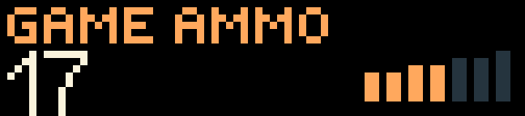

# Clip Counter

Turn the active item's virtual magazine and reserve in Counter-Strike 2 into a desktop HUD.

Use the second display for a game capture or an extra HUD beside the monitor. The active Counter-Strike 2 item and its spare rounds stay readable even when the in-game figures are small.

## Follow the active item

1. Install the included Game State Integration configuration on the PC running Counter-Strike 2. Use the same local event token in both configurations.
2. Open the bar app, then start a game session. An event for the active item populates **GAME AMMO**. An item without an ammunition field shows `--`.
3. Turn the wheel once to see the virtual reserve for that item.



## Put the magazine count back on display

1. Turn the wheel back to **GAME AMMO**. The recording returns from a reserve of 60 to a clip count of 17.
2. Press **Start** to keep that page selected while the game continues to send updates.
3. If the screen returns to standby, check that the game is still sending events and both ends use the same token.


## Example from the emulator

The fixture supplied 17 rounds in the active item and 60 in reserve. Each number has its own page. Only the active item’s data is forwarded to the BUSY Bar. Replayed documented game-state fields through the HTTP event receiver. A live CS2 match was unavailable.

## Set up the source

Copy companion/gamestate_integration_busybar.cfg into the game's csgo/cfg folder and set the same local token in it and in config.json. The game posts player_weapons events to the companion at /event. Only the current item, clip and reserve reach the bar. A knife or item without ammo shows --. When the game stops sending events the HUD goes to standby. A game on another PC must use the reachable private LAN address of the companion.

## Connect the bar

Copy companion/example.json to a private config.json and adjust it for your source. From the project folder run `python3 companion/serve.py --config config.json`. Use Python 3.10+. Set Local companion URL to `http://127.0.0.1:8770/reading` on the emulator and allow local port 8770. On hardware, bind the companion to a trusted LAN interface and set its reachable address. The wheel browses pages. Click refreshes. Start pins or unpins the current page. The last good reading is labeled offline after a source error.

## Run in the emulator

Open BUSY Bar Emulator. From this repository, run:

```sh
~/.busy-emulator/bin/busy-emulator dev --once
```

Press **Back** to exit.

The GIFs are excerpts from the emulator recording. Each front-display pixel is shown at 9× its original width and height. The end frames pause for reading.

[Full recording](media/controls.mp4) · [Rear display](screenshots/back-1.png) · [Firmware test](EMULATOR-QA.md) · [MIT license](LICENSE)
